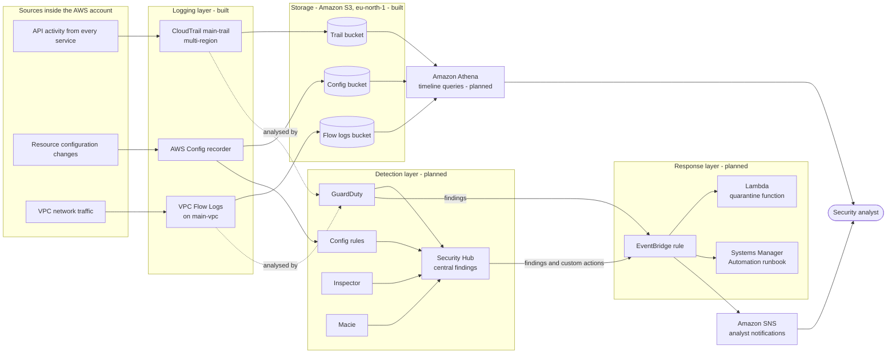

# Security / System Architecture

**Project:** DEPI Project 4 - AWS Threat Detection, Monitoring, Incident Response and Forensics
**Document owner:** Ganna | **Version:** 1.0 | **Date:** 2026-10-31

## 1. Purpose

This document shows how the lab detects, investigates and responds to incidents on AWS, and which security controls protect the platform itself. Components marked **built** exist today. Components marked **planned** are owned by other members and follow the team work plan.

## 2. Architecture diagram

## 3. Layers

| Layer | What it does | Components | Status |
|---|---|---|---|
| Sources | Everything that happens in the account | API calls, configuration changes, network flows | n/a |
| Logging | Captures the evidence | CloudTrail, AWS Config, VPC Flow Logs | Built |
| Storage | Keeps the evidence safely | Three S3 buckets in `eu-north-1` | Built |
| Analysis | Lets investigators rebuild a timeline | Athena queries over CloudTrail, Flow Logs and Config | Planned |
| Detection | Turns raw logs into findings | GuardDuty, Config rules, Inspector, Macie, aggregated in Security Hub | Planned |
| Response | Contains the incident automatically | EventBridge, Lambda, Systems Manager Automation | Planned |
| Notification | Tells a human | SNS, Security Hub custom actions | Planned |

## 4. Data flow

1. A user, role or service acts in the account. The action is recorded as a CloudTrail event, a Config change, or a network flow.
2. Each logging service delivers its files to its own S3 bucket.
3. GuardDuty analyses CloudTrail and network activity and produces findings. Config rules, Inspector and Macie add their own findings. Security Hub gathers them in one place.
4. An EventBridge rule matches a finding and starts the response: a Lambda function that quarantines the resource, and a Systems Manager runbook for the longer containment steps.
5. SNS notifies the analyst, who can also trigger manual actions from Security Hub.
6. During an investigation, the analyst runs Athena queries on the stored logs to rebuild the timeline and find the root cause.

## 5. Security controls

| Control | How it is applied | Status |
|---|---|---|
| Individual, authenticated access | Every member uses their own AWS Builder ID, with MFA on the account login | Built |
| Complete audit trail | Multi-region CloudTrail with management events, read and write | Built |
| Log integrity | CloudTrail log file validation is on | Built |
| Log protection | S3 versioning on the trail bucket, so deleted or overwritten logs can be recovered | Built |
| Retention and cost | Lifecycle rule on the trail bucket: expire after 90 days, clean noncurrent versions after 1 day | Built |
| Encryption at rest | S3 default encryption (SSE-S3) on log buckets | Built |
| No public access to logs | Block Public Access is on for the log buckets | Built |
| Configuration history | Config records all resource types, including IAM users, roles and policies | Built |
| Network visibility | VPC Flow Logs capture accepted and rejected traffic | Built |
| Spend limit | AWS Budgets monthly budget with three alerts | Built |
| Automated containment | EventBridge to Lambda and Systems Manager | Planned |
| Least privilege | Dedicated roles for Lambda and Systems Manager with only the permissions they need | Planned |

## 6. Trust boundaries

- **The AWS account** is the outer boundary. Everything in this design runs inside it.
- **The VPC `main-vpc`** is the boundary for workloads. Only test instances launched for the incident scenarios live here, and they are terminated after each lab.
- **The log buckets** are a separate, protected zone. Workloads can produce logs but should not be able to change or delete them.
- **Analysts** reach the platform only through their own identities, so every action is attributable.

## 7. Design decisions and limitations

- **Single-account trail:** the account is on the AWS Free Plan, and joining an AWS Organization would upgrade it and expire the credits. An organization trail is the production choice.
- **Default encryption instead of a customer-managed key:** chosen for cost. SSE-KMS is recommended for production.
- **Management events only:** S3 data events and Insights are off for cost. S3 data events can be enabled for the public-bucket scenario.
- **Shared project access in the lab:** project members have broad access. Production would use least-privilege roles per person.
- **Region:** everything is in `eu-north-1`. Global services such as IAM are recorded from this region.
