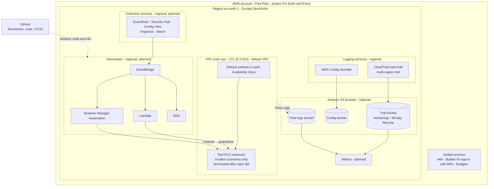

# Deployment Diagram

**Project:** DEPI Project 4 - AWS Threat Detection, Monitoring, Incident Response and Forensics
**Document owner:** Ganna | **Version:** 1.0 | **Date:** 2026-10-31

## 1. Purpose

The architecture document shows how the pieces connect logically. This diagram shows **where each piece is deployed**: which account, which region, and whether it lives inside the VPC or is a regional or global service.

## 2. Deployment diagram

## 3. Where each component lives

| Component | Location | Scope | Status |
|---|---|---|---|
| AWS account | One account, Free Plan, project "For Each and Every" | Account | Built |
| IAM, Builder ID sign-in, Budgets | Account level | Global | Built |
| VPC `main-vpc` (default VPC, `172.31.0.0/16`) | `eu-north-1` | Regional | Built |
| Test EC2 instances | Inside `main-vpc`, subnets in the default Availability Zones | VPC | Created only for the scenarios |
| S3 buckets for CloudTrail, Config and Flow Logs | `eu-north-1` | Regional | Built |
| CloudTrail `main-trail` | Multi-region trail, delivers to the trail bucket | Regional (all regions) | Built |
| AWS Config recorder | `eu-north-1` | Regional | Built |
| VPC Flow Logs | Attached to `main-vpc`, deliver to the flow logs bucket | VPC | Built |
| Athena | `eu-north-1`, reads the S3 buckets | Regional | Planned |
| GuardDuty, Security Hub, Config rules, Inspector, Macie | `eu-north-1` | Regional | Planned |
| EventBridge, Lambda, Systems Manager, SNS | `eu-north-1`, outside the VPC (serverless) | Regional | Planned |
| GitHub and GitHub Actions | Outside AWS | External | Planned |

## 4. Notes

- **Serverless components are not inside the VPC.** EventBridge, Lambda, SNS and Athena run as regional services and reach the VPC only through API calls (for example, Lambda changing the security group of a test instance).
- **Only the test EC2 instances are billed compute.** They are created for each incident scenario and terminated afterwards.
- **One region for everything.** Keeping all resources and buckets in `eu-north-1` avoids cross-region delivery and keeps the diagram simple.
- **Optional improvement:** a dedicated lab VPC, separate from the default VPC, would isolate the attack simulations. It is not needed for the current scope.
