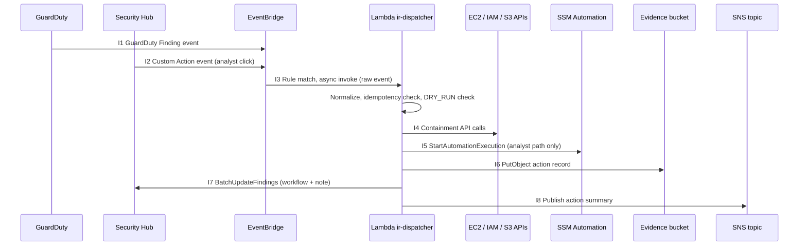

# API / Interface Documentation: EventBridge, Lambda, SSM

**Project:** DEPI Project 4 (AWS Threat Detection, Monitoring, Incident Response and Forensics), Week 4 Automation Core
**Owner:** Muhammad Hossam (Member 4) · **Pair / reviewer:** Member 6 · **Version:** 0.5 (deployed and tested in AWS, 25 Nov) · **Companion doc:** `soar-automation-flow.md`

This document defines every interface in the automated response flow: the events that enter it, the rules that route them, the Lambda function's input and output, the SSM runbook's parameters, and the records and messages it produces. Anyone building a connected part (Member 6's SNS and Security Hub actions, Ganna's evidence bucket, the scenario owners' tests) should be able to work from this document alone.

> **Status of details:** event formats, severities, finding types and API behaviour were checked against the AWS documentation on 1 Nov 2026 (sources at the end). The few items still marked **(verify)** are not stated in the docs and must be confirmed with the real findings our scenarios produce (20 - 25 Nov).

---

## 1. Interface overview



| ID | Interface | Producer | Consumer | Format | Section |
|---|---|---|---|---|---|
| I1 | GuardDuty finding event | GuardDuty | EventBridge | AWS event, `detail-type: GuardDuty Finding` | 3.1 |
| I2 | Security Hub custom action event | Security Hub | EventBridge | AWS event, ASFF findings array | 3.2 |
| I3 | Lambda invocation | EventBridge | `ir-dispatcher` | Raw EventBridge event, asynchronous | 4 |
| I4 | Containment actions | `ir-dispatcher` | EC2, IAM, S3 | AWS SDK (boto3) calls | 4.6 |
| I5 | Forensic runbook | `ir-dispatcher` | SSM Automation | `StartAutomationExecution` | 5 |
| I6 | Action record | `ir-dispatcher` | Evidence bucket, IR report, AI investigator | JSON file in S3 | 6.1 |
| I7 | Finding update | `ir-dispatcher` | Security Hub | `BatchUpdateFindings` | 6.2 |
| I8 | Notification | `ir-dispatcher` | SNS (Member 6) | JSON message | 6.3 |

---

## 2. Conventions

| Item | Convention |
|---|---|
| Region | Single region for the project: `us-east-1` (change in one place: Lambda env + IaC) |
| Timestamps | UTC, ISO 8601 (`2026-11-20T10:15:00Z`) |
| Resource names | Prefix `ir-` (e.g. `ir-dispatcher`, `ir-auto-contain-high`, `ir-dlq`) |
| Status tag | Tag key `ir:status`, written as the **last** step of a live run. `contained` = every containment step succeeded (later automatic runs skip the resource); `containment-incomplete` = a step failed (later events retry). Dry runs never tag. |
| Finding tag | Tag key `ir:finding-id` = the finding ID that caused the action |
| Versioning | Records carry `record_version`. Any breaking change to a schema bumps the major version and is announced to the team |
| Test scope | During testing, the Lambda acts only on resources tagged `env=sandbox` |

---

## 3. Inbound events (EventBridge)

### 3.1 I1: GuardDuty finding event

GuardDuty publishes every new finding to the default event bus. It also republishes a finding when it is updated (repeat occurrences are aggregated and re-sent at the configured export frequency), so **the same finding ID can arrive many times**. This is why the Lambda must be idempotent (section 4.5).

Trimmed example (fields the Lambda uses):

```json
{
  "version": "0",
  "id": "c8e2e3f1-0000-0000-0000-000000000000",
  "detail-type": "GuardDuty Finding",
  "source": "aws.guardduty",
  "account": "123456789012",
  "time": "2026-11-20T10:14:58Z",
  "region": "us-east-1",
  "detail": {
    "schemaVersion": "2.0",
    "accountId": "123456789012",
    "region": "us-east-1",
    "id": "a1b2c3d4e5f6a1b2c3d4e5f6a1b2c3d4",
    "type": "CryptoCurrency:EC2/BitcoinTool.B!DNS",
    "severity": 8,
    "title": "EC2 instance i-0abc123 is querying a domain associated with Bitcoin activity.",
    "resource": {
      "resourceType": "Instance",
      "instanceDetails": { "instanceId": "i-0abc1234567890def" }
    },
    "service": {
      "count": 1,
      "archived": false,
      "additionalInfo": { "sample": true }
    },
    "createdAt": "2026-11-20T10:10:00Z",
    "updatedAt": "2026-11-20T10:14:00Z"
  }
}
```

Resource location by `detail.resource.resourceType`:

| Condition (checked in this order) | Resource ID path | Playbook |
|---|---|---|
| Finding type contains `:S3/` **and** `s3BucketDetails` is present | `detail.resource.s3BucketDetails[0].name` | S3 |
| `resourceType` = `Instance` | `detail.resource.instanceDetails.instanceId` | EC2 |
| `resourceType` = `AccessKey`, `accessKeyDetails.userType` = `IAMUser` | `accessKeyDetails.accessKeyId` and `.userName` | IAM user key |
| `resourceType` = `AccessKey`, any other `userType` (e.g. `AssumedRole`) | `accessKeyDetails.userName` = role name **(verify)** | Temporary credentials: analyst only |
| anything else | n/a | Not supported: log, notify, no action |

Why the first row comes first: per the GuardDuty docs, S3 findings whose data source is CloudTrail **management** events (including all `Policy:S3/...` findings) have `resourceType` **`AccessKey`**, not `S3Bucket`. The access key is only the identity that changed the bucket. Routing by `resourceType` alone would deactivate that identity's key and leave the bucket public.

Why temporary credentials are separate: findings such as `UnauthorizedAccess:IAMUser/InstanceCredentialExfiltration.OutsideAWS` concern credentials issued to an EC2 instance role. They cannot be deactivated with `UpdateAccessKey`; AWS's guidance is an explicit deny policy on the role. In our design that is an analyst-approved step.

Severity bands: Low 1.0 - 3.9, Medium 4.0 - 6.9, High 7.0 - 8.9, Critical 9.0 - 10.0.

Sample findings (created with GuardDuty's *Generate sample findings*) have `"sample": true` in the finding's `additionalInfo` section (read from `detail.service.additionalInfo.sample`) (the console also shows `[SAMPLE]` at the start of the title, but the event JSON does not carry that prefix, so the Lambda checks only the `sample` field). The Lambda ignores them unless `ALLOW_SAMPLE_FINDINGS=true`.

### 3.2 I2: Security Hub custom action event

When an analyst selects findings in Security Hub and chooses a custom action, Security Hub sends one event containing the selected findings in AWS Security Finding Format (ASFF).

Custom actions to create (Member 6):

| Action ID (max 20 chars) | Name | Meaning |
|---|---|---|
| `IsolateResource` | Isolate resource | Run the containment playbook plus the analyst-only steps (session revocation; for temporary credentials, revoking the role's sessions) |
| `CollectForensics` | Collect forensics | EC2 only: start the SSM forensic runbook. On any other resource type the Lambda refuses (`action_not_applicable`) and alerts; it never falls back to containment |

Trimmed example:

```json
{
  "version": "0",
  "detail-type": "Security Hub Findings - Custom Action",
  "source": "aws.securityhub",
  "account": "123456789012",
  "region": "us-east-1",
  "resources": ["arn:aws:securityhub:us-east-1:123456789012:action/custom/IsolateResource"],
  "detail": {
    "actionName": "IsolateResource",
    "actionDescription": "Isolate the affected resource",
    "findings": [
      {
        "SchemaVersion": "2018-10-08",
        "Id": "arn:aws:guardduty:us-east-1:123456789012:detector/DETECTORID/finding/a1b2c3d4",
        "ProductArn": "arn:aws:securityhub:us-east-1::product/aws/guardduty",
        "Types": ["TTPs/Command and Control/CryptoCurrency:EC2-BitcoinTool.B!DNS"],
        "Severity": { "Label": "HIGH", "Normalized": 80 },
        "Resources": [
          { "Type": "AwsEc2Instance",
            "Id": "arn:aws:ec2:us-east-1:123456789012:instance/i-0abc1234567890def" }
        ],
        "AwsAccountId": "123456789012",
        "Region": "us-east-1"
      }
    ]
  }
}
```

Per the Security Hub docs, each selected finding is sent in a separate event. The Lambda still loops over `detail.findings` (harmless if there is only one) and writes one action record per finding.

Security Hub renames GuardDuty finding types: `UnauthorizedAccess:EC2/SSHBruteForce` becomes `TTPs/Initial Access/UnauthorizedAccess:EC2-SSHBruteForce` (a category path is added and the `/` becomes `-`). The Lambda converts them back to GuardDuty format. Findings about S3 list **both** the access key and the bucket in `Resources`; the Lambda picks the bucket.

### 3.3 EventBridge rules

**Rule `ir-auto-contain-high`** (target: `ir-dispatcher`)

```json
{
  "source": ["aws.guardduty"],
  "detail-type": ["GuardDuty Finding"],
  "detail": {
    "severity": [{ "numeric": [">=", 7] }],
    "type": [
      { "prefix": "CryptoCurrency:EC2/" },
      { "prefix": "Backdoor:EC2/" },
      { "prefix": "Trojan:EC2/" },
      { "prefix": "Impact:EC2/" },
      { "prefix": "UnauthorizedAccess:EC2/" },
      { "prefix": "UnauthorizedAccess:IAMUser/" },
      { "prefix": "Policy:S3/" }
    ]
  }
}
```

> **S3 severities (checked in the GuardDuty docs):** `Policy:S3/BucketAnonymousAccessGranted` and `Policy:S3/BucketPublicAccessGranted` are **High**, so this rule auto-contains them; these are exactly the public-bucket scenario. `Policy:S3/BucketBlockPublicAccessDisabled` and `Policy:S3/AccountBlockPublicAccessDisabled` are **Low** (turning Block Public Access off does not by itself make a bucket public), so they are not auto-contained.

> **EC2 coverage (checked in the GuardDuty docs):** the 20 EC2 types with default severity High are under `Backdoor`, `CryptoCurrency`, `Impact`, `Recon`, `Trojan` and `UnauthorizedAccess`. All are auto-contained except `Recon:EC2/PortProbeEMRUnprotectedPort`: there the instance is the **target** of a probe, and isolating a victim is the wrong response, so it is notify-only. Any High finding this rule does not match is still caught by `ir-notify` below, so **no finding of severity 4 or more goes unreported**.

**Rule `ir-auto-contain-keys`** (target: `ir-dispatcher`)

The exposed-keys scenario's findings are **Medium** by default (`UnauthorizedAccess:IAMUser/MaliciousIPCaller`, `.MaliciousIPCaller.Custom` and `.TorIPCaller`, per the GuardDuty IAM finding-types page), so the severity-7 rule above would never contain them. This rule matches those exact types at any severity. Deactivating a key is low-risk and reversible (one CLI command), and requirement US7 asks for keys to be disabled automatically. **Team decision for 6 Nov:** keep this rule, or delete it and make key deactivation an analyst click (then correct the scenario matrix).

```json
{
  "source": ["aws.guardduty"],
  "detail-type": ["GuardDuty Finding"],
  "detail": {
    "type": [
      "UnauthorizedAccess:IAMUser/MaliciousIPCaller",
      "UnauthorizedAccess:IAMUser/MaliciousIPCaller.Custom",
      "UnauthorizedAccess:IAMUser/TorIPCaller",
      "CredentialAccess:IAMUser/CompromisedCredentials"
    ]
  }
}
```

Temporary-credential and root versions of these findings still go to the analyst (section 4.5): the rule routes them, the Lambda refuses to act and sends an alert.

**Rule `ir-analyst-action`** (target: `ir-dispatcher`)

```json
{
  "source": ["aws.securityhub"],
  "detail-type": ["Security Hub Findings - Custom Action"],
  "resources": [
    "arn:aws:securityhub:us-east-1:123456789012:action/custom/IsolateResource",
    "arn:aws:securityhub:us-east-1:123456789012:action/custom/CollectForensics"
  ]
}
```

**Rule `ir-notify`** (target: SNS topic `ir-alerts`, owned by Member 6)

Every finding of severity 4 or more, including the ones the Lambda also handles. A High finding therefore produces two messages (the raw alert and the Lambda's action summary). That duplication is deliberate: it guarantees that no High finding can be missed because of a gap in the containment rules.

```json
{
  "source": ["aws.guardduty"],
  "detail-type": ["GuardDuty Finding"],
  "detail": { "severity": [{ "numeric": [">=", 4] }] }
}
```

**Target settings (all three Lambda targets):**

| Setting | Value | Why |
|---|---|---|
| Input | Matched event (no input transformer) | The Lambda needs the full finding |
| Retry policy | Maximum event age 1 hour, 3 retry attempts | Covers short outages of Lambda |
| Target dead-letter queue | SQS `ir-eventbridge-dlq` | Catches events EventBridge could not deliver |

---

## 4. Lambda `ir-dispatcher`

### 4.1 Function configuration

| Property | Value |
|---|---|
| Runtime | Python 3.12 |
| Handler | `handler.lambda_handler` |
| Memory / timeout | 256 MB / 60 s |
| Invocation | Asynchronous (from EventBridge) |
| Async retries | 2 (Lambda default) |
| On-failure destination | SQS `ir-lambda-dlq` (failed after retries) |
| Reserved concurrency | Not set. Planned value 5, but a new account has a total limit of 10 and Lambda keeps 10 unreserved, so nothing can be reserved. Set it once the quota is raised |
| Execution role | `ir-dispatcher-role` (section 7.1) |

Two dead-letter queues exist on purpose: `ir-eventbridge-dlq` catches events that never reached the function, and `ir-lambda-dlq` catches events the function failed to process.

### 4.2 Environment variables

| Variable | Required | Default | Meaning |
|---|---|---|---|
| `DRY_RUN` | yes | `true` | `true`: plan and record actions, change nothing |
| `EVIDENCE_BUCKET` | yes | none | Bucket for action records and evidence copies |
| `ISOLATION_SG_ID` | yes | none | Security group with no inbound rules and outbound HTTPS to VPC endpoints only (section 5.3) |
| `SNS_TOPIC_ARN` | yes | none | Topic for action summaries (Member 6) |
| `FORENSICS_DOCUMENT` | yes | `IR-CollectEC2Forensics` | SSM Automation runbook name |
| `AUTOMATION_ROLE_ARN` | yes | none | Role the runbook assumes |
| `ALLOW_SAMPLE_FINDINGS` | no | `false` | Act on GuardDuty sample findings (testing only) |
| `REQUIRE_SANDBOX_TAG` | no | `true` | Act only on resources tagged `env=sandbox` |
| `LOG_LEVEL` | no | `INFO` | `DEBUG` / `INFO` / `WARNING` |

### 4.3 Input

The raw EventBridge event from I1 or I2. The function detects the source from `source` and `detail-type`.

### 4.4 Normalized finding (internal contract)

The first step converts either event into one shape, so every later step handles a single format:

| Field | Type | From GuardDuty (I1) | From Security Hub (I2) |
|---|---|---|---|
| `finding_id` | string | `detail.id` | `findings[i].Id` |
| `source` | enum | `"guardduty"` | `"securityhub-custom-action"` |
| `finding_type` | string | `detail.type` | Last segment of `findings[i].Types[0]`, converted back to GuardDuty format (first `-` after the `:` becomes `/`) |
| `severity` | number 0 - 10 | `detail.severity` | `findings[i].Severity.Normalized / 10`; if missing, from `Severity.Label` (CRITICAL 9, HIGH 7, MEDIUM 4, LOW 1) |
| `resource_type` | enum `Instance`, `AccessKey`, `S3Bucket` | Table 3.1 (S3 rule first) | From the chosen resource's `Type`: `AwsEc2Instance`, `AwsIamAccessKey`, `AwsS3Bucket` (bucket preferred for S3 findings) |
| `resource_id` | string | Path in table 3.1 | EC2 and S3: parsed from the resource ARN. Access key: `Details.AwsIamAccessKey.AccessKeyId` |
| `user_name` | string or null | `accessKeyDetails.userName` | `Details.AwsIamAccessKey.PrincipalName` |
| `user_type` | string or null | `accessKeyDetails.userType` | `Details.AwsIamAccessKey.PrincipalType` |
| `account_id` | string | `detail.accountId` | `findings[i].AwsAccountId` |
| `region` | string | `detail.region` | `findings[i].Region` |
| `triggered_by` | enum | `"auto"` | `"analyst"` |
| `requested_action` | enum or null | null | `detail.actionName` (`IsolateResource`, `CollectForensics`) |
| `is_sample` | bool | `service.additionalInfo.sample` | false |
| `sh_identifier` | object or null | null | `{"Id": findings[i].Id, "ProductArn": findings[i].ProductArn}` |

### 4.5 Processing order and guarantees

1. **Normalize** the event (4.4). Unsupported resource type: record `skipped`, notify, stop.
2. **Sample filter:** if `is_sample` and not `ALLOW_SAMPLE_FINDINGS`: record `skipped`, stop.
3. **Credentials and action checks:** `CollectForensics` on a non-EC2 resource → `action_not_applicable`. Root credentials → `root_credentials_need_analyst` (never automated, on either path). Temporary credentials on the automatic path → `temporary_credentials_need_analyst`. In all three cases: record `skipped`, alert the analysts, stop.
4. **Scope check:** if `REQUIRE_SANDBOX_TAG` and the resource lacks `env=sandbox` (for temporary credentials: the role's tags): record `skipped` (`out_of_scope`), stop. If the severity is 7 or more, also alert, so a forgotten tag in the scenario week cannot silently disable the automation.
5. **Idempotency** (automatic runs only): if the resource is tagged `ir:status=contained` **by this same finding** (`ir:finding-id` matches), or an earlier action record for this finding has result `ok` (live) or `dry_run` (dry run, which never tags), the event is a duplicate: log only, no record, no alert, because GuardDuty re-sends updated findings. If the resource is contained but by a **different** finding, record `skipped` (`resource_already_contained`) and alert, so the new finding is not lost. Analyst requests always run, because an analyst may deliberately ask for the analyst-only steps.
6. **Plan** the steps for the playbook (4.6), choosing auto or analyst steps by `triggered_by`.
7. **Execute** each step, or mark it `planned` in dry-run. Steps run in the listed order. **Evidence steps always come first**; if one fails, the containment steps after it are not run (the record shows why). **`tag_resource` always runs last**, so a resource is only tagged `contained` after containment really succeeded.
8. **Record and report:** write the action record (I6), update Security Hub if `sh_identifier` exists (I7), publish to SNS (I8).

### 4.6 Action catalog

| Action name (in records) | Playbook | Path | AWS API call | Key parameters | Reversible? |
|---|---|---|---|---|---|
| `capture_instance_metadata` | EC2 | auto | `ec2:DescribeInstances` | `InstanceIds=[id]` → saved to evidence bucket | n/a |
| `snapshot_volumes` | EC2 | auto | `ec2:CreateSnapshots` | `InstanceSpecification.InstanceId`, tags `ir:finding-id` | n/a (adds evidence) |
| `swap_security_group` | EC2 | auto | `ec2:ModifyInstanceAttribute`; for instances with several network interfaces, `ec2:ModifyNetworkInterfaceAttribute` per interface | `Groups=[ISOLATION_SG_ID]` (original groups per interface saved in the record) | Yes |
| `revoke_role_sessions` | EC2 | analyst | `iam:PutRolePolicy` | Inline deny-all policy with `aws:TokenIssueTime` older than now, on the instance role | Yes (delete policy) |
| `start_forensics` | EC2 | analyst | `ssm:StartAutomationExecution` | Section 5 | n/a |
| `deactivate_access_key` | IAM key | auto | `iam:UpdateAccessKey` | `UserName`, `AccessKeyId`, `Status=Inactive` | Yes |
| `revoke_user_sessions` | IAM key | analyst | `iam:PutUserPolicy` | Inline deny-all with `aws:TokenIssueTime` condition | Yes (delete policy) |
| `revoke_principal_role_sessions` | Temporary credentials | analyst | `iam:PutRolePolicy` | Same deny policy, on the role named in the finding | Yes (delete policy) |
| `capture_bucket_config` | S3 | auto | `s3:GetBucketPolicy`, `s3:GetBucketAcl`, `s3:GetPublicAccessBlock` | Saved to evidence bucket before change | n/a |
| `block_public_access` | S3 | auto | `s3:PutPublicAccessBlock` | All four settings `true` | Yes |

Notes:
- For instances with more than one network interface, `ModifyInstanceAttribute` can fail (AWS docs), so the Lambda automatically calls `ModifyNetworkInterfaceAttribute` on each interface instead. No analyst step is needed.
- Security groups are stateful: connections already open may continue after the swap. This is documented as a known limitation in the SOAR design.
- Keys are never deleted and buckets are never deleted: deletion destroys evidence and cannot be undone.

### 4.7 Return value

The function returns (and logs) one summary per processed finding:

```json
{
  "status": "ok",
  "finding_id": "a1b2c3d4e5f6a1b2c3d4e5f6a1b2c3d4",
  "record_key": "s3://ir-evidence-bucket/actions/a1b2c3d4e5f6a1b2c3d4e5f6a1b2c3d4/ok/2026-11-20T10-15-00Z-5f0c1e2d-0000-0000-0000-000000000000.json",
  "steps_done": 4,
  "steps_failed": 0
}
```

| `status` | Meaning |
|---|---|
| `ok` | All planned steps succeeded |
| `dry_run` | Steps planned and recorded, nothing changed |
| `skipped` | Not acted on. `reason` is one of: `unsupported_resource`, `action_not_applicable`, `root_credentials_need_analyst`, `sample_finding`, `temporary_credentials_need_analyst`, `resource_not_found`, `out_of_scope`, `resource_already_contained`, `scope_check_denied`, `already_contained`. All except `sample_finding`, `already_contained` and low-severity `out_of_scope` send an alert |
| `partial` | Some steps failed. Evidence and any successful steps are kept and the record lists the failures |
| `error` | The function could not process the finding at all. The exception is raised so Lambda retries and then sends the event to `ir-lambda-dlq` |

Step-level error codes (in `steps[].error`): `ACCESS_DENIED`, `RESOURCE_NOT_FOUND`, `THROTTLED`, `PRECONDITION_FAILED` (for example, an evidence step failed), `UNKNOWN`.

---

## 5. SSM Automation runbook `IR-CollectEC2Forensics`

### 5.1 Interface

| Parameter | Type | Required | Meaning |
|---|---|---|---|
| `InstanceId` | String | yes | Target instance |
| `EvidenceBucket` | String | yes | Where outputs are uploaded |
| `FindingId` | String | yes | Used as the S3 prefix and tag |
| `AutomationAssumeRole` | String (ARN) | yes | Role the runbook runs as (7.2) |

Call made by the Lambda:

```python
ssm.start_automation_execution(
    DocumentName="IR-CollectEC2Forensics",
    Parameters={
        "InstanceId": [instance_id],
        "EvidenceBucket": [evidence_bucket],
        "FindingId": [finding_id],
        "AutomationAssumeRole": [automation_role_arn],
    },
)
# returns {"AutomationExecutionId": "..."} -> stored in the action record step detail
```

### 5.2 Runbook steps (file: `ssm/IR-CollectEC2Forensics.yaml`, tested in AWS on 25 Nov)

| Step | Action type | What it does |
|---|---|---|
| 1 `waitForSsmAgent` | `aws:waitForAwsResourceProperty` | Waits up to 5 minutes for the SSM agent to report `Online`; aborts otherwise |
| 2 `collectHashAndUpload` | `aws:runCommand` with `AWS-RunShellScript` | Processes, network connections, logged-in users, recent logins, auth/system log, cron, accounts and SSH keys; writes `SHA256SUMS` for every file; uploads all to `s3://<EvidenceBucket>/forensics/<FindingId>/`. Read-only on the instance |
| 3 `tagInstance` | `aws:createTags` | `ir:forensics=collected` on the instance |

Every parameter has an `allowedPattern`, because the values are placed inside a shell script: an instance ID or finding ID containing shell characters is rejected before anything runs.

Outputs: `AutomationExecutionId`, S3 prefix of collected files, step statuses (read with `ssm:GetAutomationExecution`).

### 5.3 Prerequisites (important)

- The instance needs the **SSM agent** and an instance profile allowing SSM.
- **Isolation conflict:** an isolation security group with no outbound traffic also blocks the SSM agent. Two options: (a) run forensics **before** the swap, or (b) VPC interface endpoints for `ssm`, `ssmmessages` and `ec2messages` plus an S3 gateway endpoint, with the isolation group allowing outbound HTTPS **only** to them. Option (b) is written out in the README (section 2d), including two trade-offs: interface endpoints are charged per hour (create them for the scenario week only), and the S3 endpoint policy applies to **every** instance whose route table uses it, so it belongs in the scenario VPC only. Decision with Ganna (network) by 13 Nov.

---

## 6. Outputs

### 6.1 I6: Action record (S3)

Key layout: `s3://<EVIDENCE_BUCKET>/actions/<finding_id>/<result>/<started_at>-<lambda_request_id>.json` (one file per run; runs never overwrite each other). Finding IDs that contain `/` or `:` (Security Hub ARNs) are made S3-safe by replacing those characters with `_`.

| Field | Type | Meaning |
|---|---|---|
| `record_version` | string | Schema version, currently `1.0` |
| `finding_id`, `finding_type`, `severity` | string, string, number | From the normalized finding |
| `source`, `triggered_by`, `requested_action` | enums | Who or what caused the run |
| `resource` | object | `{type, id, user_name, account_id, region}` |
| `dry_run` | bool | Whether anything was actually changed |
| `started_at`, `finished_at` | timestamps | Used for time-to-contain measurements |
| `steps[]` | array | `{action, target, status: planned / done / failed / skipped, detail, error}` |
| `previous_state` | object | What was changed from, for example original security groups, so steps can be reversed |
| `result` | enum | Same values as the return `status` |
| `lambda_request_id` | string | Links the record to the CloudWatch log entry |
| `finding_created_at` | timestamp | When the finding was created; with `finished_at`, the automated time-to-contain KPI |
| `evidence[]` | array | `{uri, sha256, collected_at}` for every evidence file (chain of custody) |
| `reason` | string or null | Why a run was skipped |

```json
{
  "record_version": "1.0",
  "finding_id": "a1b2c3d4e5f6a1b2c3d4e5f6a1b2c3d4",
  "finding_type": "CryptoCurrency:EC2/BitcoinTool.B!DNS",
  "severity": 8.0,
  "source": "guardduty",
  "triggered_by": "auto",
  "requested_action": null,
  "resource": {"type": "Instance", "id": "i-0abc1234567890def", "user_name": null,
               "account_id": "123456789012", "region": "us-east-1"},
  "dry_run": true,
  "finding_created_at": "2026-11-20T10:10:00Z",
  "started_at": "2026-11-20T10:15:00Z",
  "finished_at": "2026-11-20T10:15:07Z",
  "steps": [
    {"action": "capture_instance_metadata", "target": "i-0abc1234567890def", "status": "planned", "detail": null, "error": null},
    {"action": "snapshot_volumes", "target": "i-0abc1234567890def", "status": "planned", "detail": null, "error": null},
    {"action": "swap_security_group", "target": "i-0abc1234567890def", "status": "planned", "detail": null, "error": null},
    {"action": "tag_resource", "target": "i-0abc1234567890def", "status": "planned", "detail": null, "error": null}
  ],
  "previous_state": {},
  "evidence": [],
  "result": "dry_run",
  "reason": null,
  "lambda_request_id": "5f0c1e2d-0000-0000-0000-000000000000"
}
```

### 6.2 I7: Security Hub finding update

Only when the run came from Security Hub (or the finding exists in Security Hub):

```python
securityhub.batch_update_findings(
    FindingIdentifiers=[{"Id": finding_id, "ProductArn": product_arn}],
    Workflow={"Status": "NOTIFIED"},
    Note={"Text": "ir-dispatcher: snapshot_volumes done, swap_security_group done. Record: s3://...",
          "UpdatedBy": "ir-dispatcher"},
)
```

The note text is kept under 512 characters (the Security Hub limit). In dry-run mode only the note is added; the workflow status is not changed.

### 6.3 I8: SNS message (contract with Member 6)

Topic: `ir-alerts`. Message attributes: `severity` (Number), `result` (String), so subscribers can filter.

```json
{
  "subject": "[IR][HIGH] EC2 i-0abc1234567890def contained (dry run)",
  "finding_id": "a1b2c3d4e5f6a1b2c3d4e5f6a1b2c3d4",
  "finding_type": "CryptoCurrency:EC2/BitcoinTool.B!DNS",
  "severity": 8.0,
  "resource": "i-0abc1234567890def",
  "triggered_by": "auto",
  "result": "dry_run",
  "steps": ["capture_instance_metadata: planned", "snapshot_volumes: planned",
            "swap_security_group: planned", "tag_resource: planned"],
  "next_analyst_actions": ["revoke_role_sessions", "start_forensics"],
  "record": "s3://ir-evidence-bucket/actions/a1b2c3d4.../2026-11-20T10-15-07Z.json"
}
```

Member 6 owns the human-readable email template built from these fields.

---

## 7. IAM roles

### 7.1 `ir-dispatcher-role` (Lambda execution role)

| Purpose | Actions | Resource scope |
|---|---|---|
| Read and tag EC2 | `ec2:DescribeInstances`, `ec2:CreateTags` | `*` for Describe; tags limited by condition `aws:ResourceTag/env = sandbox` during testing |
| Snapshot | `ec2:CreateSnapshots`, `ec2:CreateTags` on snapshots | Instances and volumes in the account |
| Isolate | `ec2:ModifyInstanceAttribute` (instances tagged `env=sandbox`), `ec2:ModifyNetworkInterfaceAttribute` (network interfaces) | Plus the isolation security group itself |
| IAM key containment | `iam:UpdateAccessKey`, `iam:TagUser`, `iam:ListUserTags`, `iam:PutUserPolicy` | Users tagged `env=sandbox` |
| Role sessions | `iam:GetInstanceProfile`, `iam:ListRoleTags`, `iam:PutRolePolicy`, `iam:TagRole` | Roles tagged `env=sandbox` (tag the sandbox instance roles) |
| S3 containment and evidence | `s3:GetBucketPolicy`, `s3:GetBucketAcl`, `s3:GetBucketPublicAccessBlock`, `s3:PutBucketPublicAccessBlock`, `s3:GetBucketTagging`, `s3:PutBucketTagging` | Buckets in the account, except the evidence and log buckets (explicit deny) |
| Write and check records | `s3:PutObject` on `actions/*` and `evidence/*`; `s3:ListBucket` on the evidence bucket (condition `s3:prefix` = `actions/*`) | Evidence bucket only |
| Report | `securityhub:BatchUpdateFindings`, `sns:Publish` | The one topic ARN |
| Forensics | `ssm:StartAutomationExecution` | The `IR-CollectEC2Forensics` document only |
| Pass the automation role | `iam:PassRole` | `AUTOMATION_ROLE_ARN` only, condition `iam:PassedToService = ssm.amazonaws.com` |
| Failure destination | `sqs:SendMessage` | `ir-lambda-dlq` |
| Logs | `logs:CreateLogGroup`, `logs:CreateLogStream`, `logs:PutLogEvents` | The function's log group |

Not granted on purpose: any `Delete*` action, `iam:DeleteAccessKey`, `s3:DeleteBucket`, `ec2:TerminateInstances`.

**Known limits of this policy (accepted for the lab, stated so reviewers do not have to find them):**
- `iam:PutUserPolicy` and `iam:PutRolePolicy` can write *any* inline policy, including an `Allow *`. IAM has no condition key that restricts the content of an inline policy, so whoever can change the Lambda's code could misuse the role. Mitigations: the code only ever writes the fixed deny policy; the actions are limited to resources tagged `env=sandbox`; and only Muhammad and Member 6 may update the function (`lambda:UpdateFunctionCode`).
- `ModifyNetworkInterfaceAttribute` and the S3 `PutBucketPublicAccessBlock` / `PutBucketTagging` statements have no `env=sandbox` condition, because network interfaces are usually untagged and bucket-tag conditions were not verified. For these, the sandbox limit is enforced by the code's scope check only.

> This table supersedes section 7 of `soar-automation-flow.md`. It adds the read permissions needed for the idempotency check and evidence capture (`iam:ListUserTags`, `s3:GetBucketTagging`, `s3:GetBucketAcl`, `s3:GetBucketPublicAccessBlock`), `ec2:CreateSnapshots`, `iam:PutRolePolicy`, `iam:PassRole` and `sqs:SendMessage`.

### 7.2 `ir-forensics-automation-role` (assumed by SSM)

Files: `iam/forensics-automation-trust-policy.json` (trust `ssm.amazonaws.com`, limited to our account) and `iam/forensics-automation-policy.json`: `ssm:SendCommand` only with the `AWS-RunShellScript` document and only on instances tagged `env=sandbox` (condition key `ssm:resourceTag/env`, confirmed working on 25 Nov), read access to follow the command, `ec2:CreateTags` on sandbox instances, and `ec2:DescribeTags` (the `aws:createTags` step reads the tags back to verify them; without it the step fails).

The **instance profile** of each sandbox instance (not this role) needs `AmazonSSMManagedInstanceCore` plus `iam/sandbox-instance-forensics-upload-policy.json` (`s3:PutObject` on `forensics/*` only), because the upload runs on the instance.

---

## 8. Error handling summary

| Failure | Where it is caught | Result |
|---|---|---|
| EventBridge cannot invoke the function | EventBridge retry policy | After 3 attempts / 1 hour: `ir-eventbridge-dlq` |
| Function throws (bug, timeout) | Lambda async retries | After 2 retries: `ir-lambda-dlq` |
| One AWS call fails (e.g. AccessDenied) | Inside the function, per step | Step `failed` with error code, run `partial`, analysts notified |
| Evidence step fails | Inside the function | Later containment steps `skipped` with `PRECONDITION_FAILED` |
| Duplicate event | Idempotency check (4.5 step 5) | `skipped: already_contained` |
| Throttling | boto3 standard retry mode (up to 3) | If still throttled: step `failed: THROTTLED` |

Operators check both DLQs daily during the scenario week (20 - 25 Nov).

---

## 9. Testing the interfaces

| Test | How | Expected |
|---|---|---|
| Parser | Unit tests with the sample events in this document (one per resource type, plus a Security Hub custom action) | Correct normalized finding |
| Lambda end to end, no AWS changes | `aws lambda invoke --function-name ir-dispatcher --payload file://events/gd-ec2-high.json out.json` with `DRY_RUN=true` | `status: dry_run`, record in S3, SNS message |
| EventBridge rule match | `aws events test-event-pattern --event-pattern file://rules/ir-auto-contain-high.json --event file://events/gd-ec2-high.json` | `true` |
| Real GuardDuty path | GuardDuty *Generate sample findings* with `ALLOW_SAMPLE_FINDINGS=true` and `DRY_RUN=true` | Records for each supported sample type |
| Idempotency | Invoke the same event twice | Second run: `skipped: already_contained` |
| Live containment | Scenario week, sandbox only, `DRY_RUN=false`, agreed with the team | Resources contained, records complete |

Note: do not plan to fake GuardDuty or Security Hub events with `aws events put-events`. Events with `source: aws.*` are meant to come from AWS services, and custom events with that source are not expected to be accepted (**verify**: the CLI reference does not state the rule). Direct Lambda invocation, `test-event-pattern` and GuardDuty sample findings cover every test without it.

---

## 10. Open items

| # | Item | Owner | Due |
|---|---|---|---|
| 1 | Confirm `userName` = role name for temporary-credential findings (sample findings reaching EventBridge: **confirmed** 25 Nov) | Muhammad | Scenario week |
| 2 | Create custom actions `IsolateResource`, `CollectForensics` and share ARNs | Member 6 | 13 Nov |
| 3 | Isolation vs SSM: **decided** – run forensics before isolation; no VPC endpoints (about $20/month). An isolated instance cannot reach SSM (documented limitation) | Muhammad + Ganna | Done |
| 4 | Region **eu-north-1**; evidence bucket `depi-ir-automation-evidence-<account>` (Object Lock, GOVERNANCE 30 days) | Muhammad | Done |
| 5 | Agree the auto-contain finding list | Team | 6 Nov |

## 11. Deployment results (25 Nov 2026)

Deployed with the AWS CLI from CloudShell into the team account, region eu-north-1.

| Test | Result |
|---|---|
| IAM Access Analyzer `validate-policy` on `ir-dispatcher-policy` | 0 findings |
| Direct invoke, sample event (fake instance) | `skipped: resource_not_found`, record written to S3 |
| Direct invoke, dry run on a real sandbox instance | `dry_run`, 4 steps planned, nothing changed |
| Live containment on a real sandbox instance | `ok`, 4/4 steps (metadata, snapshot, isolation SG, tag) in **about 5 s** (KPI: automated response ≤ 2 min) |
| GuardDuty sample finding → EventBridge → Lambda | Received automatically, `skipped: sample_finding` record within seconds |
| `ir-notify` rule → SNS | Email received for the sample finding (severity ≥ 4) |
| SSM runbook `IR-CollectEC2Forensics` | 3/3 steps succeeded after adding `ec2:DescribeTags`; 9 evidence files + `SHA256SUMS` in S3; `sha256sum -c` all OK (evidence unchanged) |

**Constraints found in the account**

| Constraint | Effect | Handling |
|---|---|---|
| Organization SCP allows only eu-north-1 | Any call to another region is denied | Sample events and templates must use eu-north-1; denied scope checks now return `scope_check_denied` |
| Lambda concurrency limit 10 (new account) | Reserved concurrency cannot be set | Documented in section 4.1 |
| No VPC endpoints, public subnet only | Isolated instances cannot reach SSM | Forensics runs before isolation |

## Change log

| Version | Date | Change |
|---|---|---|
| 0.1 | 2026-10-28 | First draft for the 6 Nov design review |
| 0.2 | 2026-10-28 | Aligned with the Lambda skeleton: record key layout, idempotency via records, `s3:ListBucket` and `iam:GetInstanceProfile` added, dry-run adds a Security Hub note without changing workflow status |
| 0.3 | 2026-11-01 | Review against AWS docs: S3 findings routed by bucket (they arrive as `AccessKey`), temporary credentials separated, multi-interface isolation, tag written last, ASFF type conversion, S3 severities and sample marker confirmed, put-events claim softened |
| 0.4 | 2026-11-02 | Peer review fixes: Trojan/Impact EC2 types added, exposed-key rule (Medium severity), notify rule covers severity >= 4, CollectForensics refused on non-EC2, new findings on contained resources alerted, out_of_scope alerted at severity >= 7, root credentials never automated, evidence SHA-256 and finding time in the record, SSM runbook, automation role and evidence bucket added |
| 0.5 | 2026-11-25 | Deployed and tested in AWS (eu-north-1): `scope_check_denied` skip reason (an access-denied scope check is recorded and alerted instead of crashing), `ec2:DescribeTags` added to the forensics role, reserved concurrency not set (account limit), results in section 11 |

## Sources checked (1 Nov 2026)

- GuardDuty, processing findings with EventBridge: https://docs.aws.amazon.com/guardduty/latest/ug/guardduty_findings_eventbridge.html
- GuardDuty severity levels: https://docs.aws.amazon.com/guardduty/latest/ug/guardduty_findings-severity.html
- GuardDuty sample findings: https://docs.aws.amazon.com/guardduty/latest/ug/sample_findings.html
- GuardDuty S3 finding types (resource types and default severities): https://docs.aws.amazon.com/guardduty/latest/ug/guardduty_finding-types-s3.html
- GuardDuty integration with Security Hub (ASFF type mapping): https://docs.aws.amazon.com/guardduty/latest/ug/securityhub-integration.html
- Security Hub EventBridge event formats (custom actions): https://docs.aws.amazon.com/securityhub/latest/userguide/securityhub-cwe-event-formats.html
- ASFF AwsIamAccessKey details: https://docs.aws.amazon.com/securityhub/latest/userguide/asff-resourcedetails-awsiam.html
- EC2 ModifyInstanceAttribute (multiple network interfaces note): https://docs.aws.amazon.com/AWSEC2/latest/APIReference/API_ModifyInstanceAttribute.html
- EC2 security group connection tracking: https://docs.aws.amazon.com/AWSEC2/latest/UserGuide/security-group-connection-tracking.html
- Resolving GuardDuty credential exfiltration findings: https://aws.amazon.com/premiumsupport/knowledge-center/resolve-guardduty-credential-alerts/
