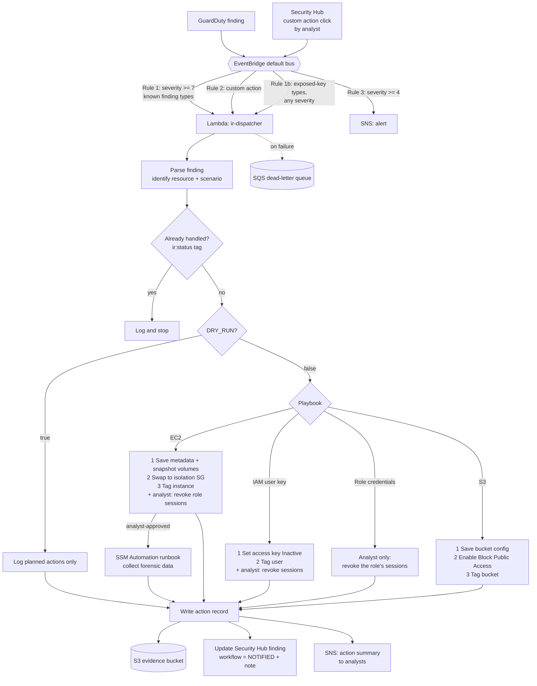

# Week 4: SOAR Design and Automation Flow (Draft)

**Owner:** Muhammad Hossam (Member 4) · **Pair:** Member 6 · **Status:** Deployed and tested in AWS (eu-north-1) on 25 Nov; results in `api-interface-documentation.md` section 11 · A rendered copy of the diagram is in `soar-automation-flow.png`
**Scope:** Automated and analyst-approved response to GuardDuty / Security Hub findings for the three Project 4 scenarios.

---

## 1. Design principles

| Principle | What it means in practice |
|---|---|
| **Preserve evidence first** | Snapshot / tag before any change. Disable keys, never delete them. |
| **Least disruptive action** | Isolate, don't terminate. Block public access, don't delete the bucket. |
| **Human in the loop for risky actions** | Auto-contain only High/Critical findings of known types. Everything else needs an analyst click (Security Hub custom action). |
| **Dry-run by default** | `DRY_RUN=true` until the team signs off. The Lambda logs what it *would* do. |
| **Idempotent** | GuardDuty re-sends updated findings (every 6 hours by default) and EventBridge can deliver twice. Check the `ir:status` tag and earlier records before acting. The tag is written **last**, so a failed containment is retried, not skipped. |
| **Everything is recorded** | Each run writes one structured *action record* (section 6), used for the IR report and later by the AI investigator. |

---

## 2. End-to-end flow

---

## 3. EventBridge rules

| Rule | Matches | Target | Owner |
|---|---|---|---|
| `ir-auto-contain-high` | GuardDuty, severity >= 7, types starting `Backdoor:EC2/`, `CryptoCurrency:EC2/`, `Trojan:EC2/`, `Impact:EC2/`, `UnauthorizedAccess:EC2/`, `UnauthorizedAccess:IAMUser/`, `Policy:S3/` | `ir-dispatcher` Lambda | Muhammad |
| `ir-auto-contain-keys` | GuardDuty exposed-key types (`UnauthorizedAccess:IAMUser/MaliciousIPCaller`, `.Custom`, `.TorIPCaller`, `CredentialAccess:IAMUser/CompromisedCredentials`) at **any** severity, because AWS rates them Medium | `ir-dispatcher` Lambda | Muhammad |
| `ir-analyst-action` | Security Hub custom actions *Isolate resource* and *Collect forensics* | `ir-dispatcher` Lambda | Muhammad + Member 6 |
| `ir-notify` | GuardDuty, severity >= 4 (overlaps the rules above on purpose, so no finding of severity 4+ is ever unreported) | SNS topic | Member 6 |

Exact JSON patterns: `api-interface-documentation.md` section 3.3 and the `rules/` folder.

---

## 4. Scenario-to-action matrix

Finding types are examples. Confirm against the GuardDuty finding-type list and the findings our scenarios actually produce (20 to 25 Nov).

| Scenario | Example finding types | Automatic | Analyst-approved | Evidence kept |
|---|---|---|---|---|
| **Compromised EC2** (Menna) | High types under `CryptoCurrency:EC2/`, `Backdoor:EC2/`, `Trojan:EC2/`, `Impact:EC2/`, `UnauthorizedAccess:EC2/` | Snapshot volumes, tag, swap to isolation security group | Revoke instance-role sessions, run SSM forensic runbook | EBS snapshots, SSM output, action record |
| **Exposed access keys** (Member 5) | `UnauthorizedAccess:IAMUser/MaliciousIPCaller`, `.TorIPCaller` (IAM **user** keys; AWS default severity **Medium**, matched by rule `ir-auto-contain-keys`) | Set key **Inactive**, tag user (team to confirm by 6 Nov) | Revoke the user's active sessions | CloudTrail for the key, action record |
| **Exfiltrated instance credentials** (EC2 scenario) | `UnauthorizedAccess:IAMUser/InstanceCredentialExfiltration.*` (temporary role credentials; cannot be deactivated) | None: notify analysts | Revoke the role's sessions (deny policy on the role, per AWS guidance) | CloudTrail for the role, action record |
| **Public S3 bucket** (Member 5) | `Policy:S3/BucketAnonymousAccessGranted`, `Policy:S3/BucketPublicAccessGranted` (both **High**; they arrive with resource type `AccessKey`, the bucket is in `s3BucketDetails`) | Save bucket config, enable bucket Block Public Access, tag bucket | Review and remove public ACL / bucket-policy statements | Bucket config before change, action record |

**Root credentials:** findings about the root user are never acted on automatically. The Lambda records them and alerts the analysts.

**Known limitation (confirmed in the AWS docs):** "When you change a security group rule, its tracked connections are not immediately interrupted." Swapping to the isolation group therefore does not cut connections that are already open. AWS's documented way to break them is a network ACL that blocks the traffic (network ACLs are stateless). Because a NACL applies to the whole subnet, that step is analyst-only. Instances with more than one network interface are isolated interface by interface, because `ModifyInstanceAttribute` can fail for them.

---

## 5. Lambda `ir-dispatcher`

One Python 3.12 function handles both GuardDuty findings and Security Hub custom actions. It normalizes them into one shape, decides whether to act (sample, scope, temporary or root credentials, duplicates), runs the playbook with evidence first and the status tag last, and reports. Full contract (environment variables, field mapping, processing order, action catalog, return codes): `api-interface-documentation.md` section 4.

## 6. Action record (shared output contract)

One JSON file per run at `s3://<EVIDENCE_BUCKET>/actions/<finding_id>/<result>/<started_at>-<request id>.json`, including the SHA-256 of every evidence file and the finding's creation time (for time-to-contain KPIs). The final IR report and the graduation project's AI investigator both read this format. Full schema: `api-interface-documentation.md` section 6.1.

---

## 7. IAM permissions for `ir-dispatcher` (least privilege, draft)

> Superseded by section 7 of `api-interface-documentation.md`, which adds the read, snapshot, PassRole and DLQ permissions this draft missed.

| Purpose | Actions |
|---|---|
| EC2 containment | `ec2:DescribeInstances`, `ec2:CreateSnapshot`, `ec2:CreateTags`, `ec2:ModifyInstanceAttribute` |
| IAM key containment | `iam:UpdateAccessKey`, `iam:TagUser`, `iam:PutUserPolicy` (deny-all, analyst path only) |
| S3 containment | `s3:PutBucketPublicAccessBlock`, `s3:GetBucketPolicy`, `s3:PutBucketTagging` |
| Evidence and reporting | `s3:PutObject` on the evidence bucket only, `securityhub:BatchUpdateFindings`, `sns:Publish` on one topic |
| Forensics | `ssm:StartAutomationExecution` for the named runbook only |
| Logging | `logs:CreateLogStream`, `logs:PutLogEvents` |

Scope resources with ARNs and conditions where possible (for example, only instances tagged `env=sandbox` during testing).

---

## 8. Dependencies and hand-offs

| Needs | From | By |
|---|---|---|
| GuardDuty and Security Hub enabled | Mariam | before 7 Nov |
| SNS topics + Security Hub custom action ARN | Member 6 | 7 - 13 Nov |
| Real findings from the three scenarios | Menna, Member 5 | 20 - 25 Nov |
| Isolation security group + evidence bucket | Muhammad (with Ganna for the bucket) | 7 - 13 Nov |

## 9. Open questions for the team

1. Which findings should auto-contain, and which should only notify? (Proposal above: High/Critical of known types only.)
2. Who may click the Security Hub custom actions in the demo?
3. Evidence bucket: reuse Ganna's log bucket with a separate prefix, or a dedicated bucket with Object Lock?
4. Sandbox account only? (Recommended: yes, and scope the Lambda to `env=sandbox` resources.)
